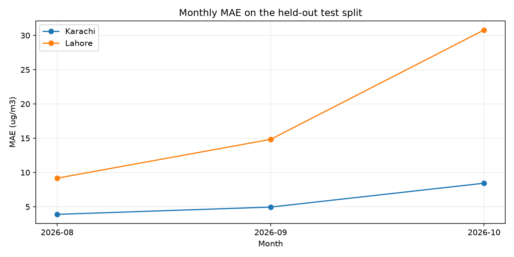
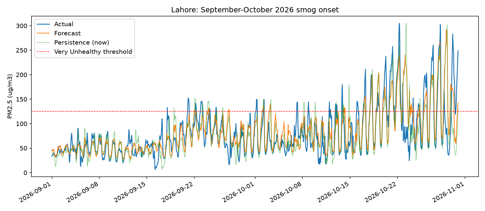
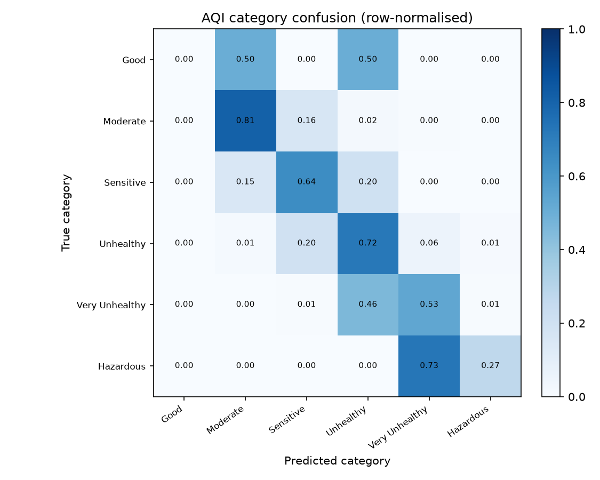
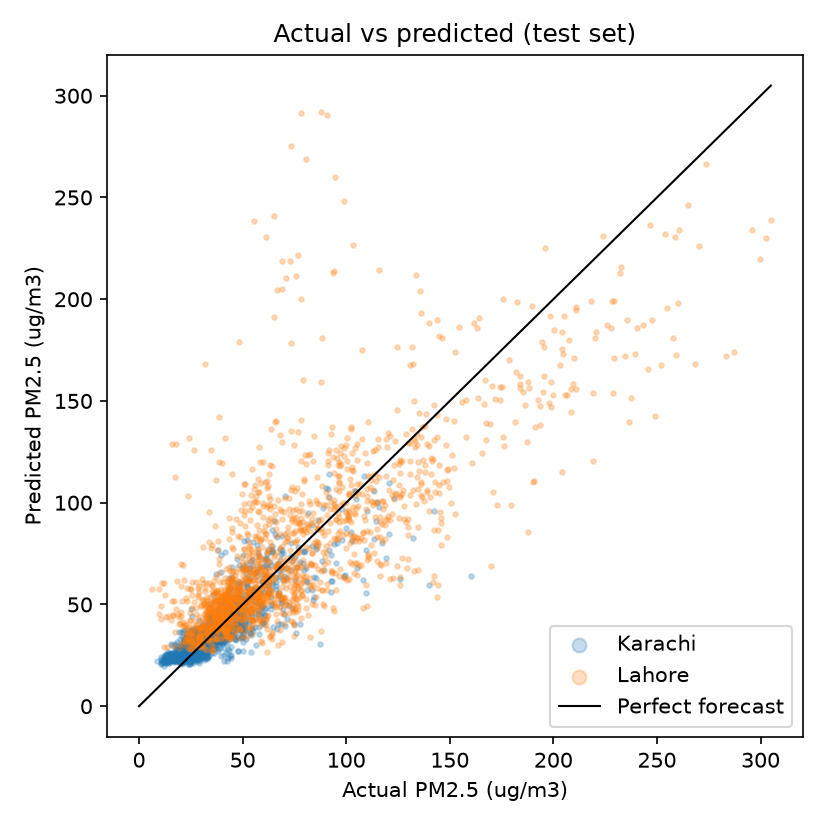

# Next-Day Air Quality (PM2.5) Forecasting for Karachi and Lahore

**Course:** CT-378 Machine Learning, Semester Project  
**Team:** Khubsoorat Shklen  
**Members:** Muhammad Sarim Umer (CT-24235), Muhammad Feras Malik (CT-24247), Muhammad Ahmed Khan (CT-24245)

---

## Abstract

Air pollution in Pakistan's two largest cities regularly exceeds healthy levels, yet
most public tools report only the current reading. This project builds a supervised
time-series regression system that forecasts PM2.5 concentration **24 hours ahead**
for Karachi and Lahore. Hourly PM2.5 from community OpenAQ sensors is combined with
Open-Meteo weather and CAMS regional aerosol fields. Forty-seven leakage-safe
features describe recent pollution history, weather, calendar effects, atmospheric
stagnation, and smog-season risk. A chronological 70/15/15 split with a 24-hour
purge gap prevents future information from leaking into training. Ridge, KNN,
Random Forest, and LightGBM are compared with `TimeSeriesSplit` tuning; a weighted
ensemble of Ridge, Random Forest, and LightGBM is selected. On the untouched test
split it achieves **MAE 13.31 µg/m³, RMSE 23.65, R² 0.6695, and 71.6% AQI-category
accuracy**, beating the persistence baseline (MAE 14.54, AQI 70.0%). The prediction
is converted into a US EPA AQI category and actionable health advice and served
through a Streamlit app, a FastAPI `/predict` endpoint, and a Hugging Face
Spaces-ready deployment bundle.

---

## 1. Introduction

PM2.5 particles are small enough to reach the lungs and bloodstream and are linked
to respiratory and cardiovascular illness. Karachi and Lahore face different
pollution regimes: Karachi is coastal and comparatively stable, while Lahore
experiences severe winter smog driven by crop-residue burning, temperature
inversions, and stagnant air. A useful warning system should answer questions such
as "should I exercise outdoors tomorrow?" and "should my children wear a mask to
school?" before the exposure happens.

Machine learning is appropriate because PM2.5 depends on interacting processes:
autocorrelation, weather dispersion, humidity-driven particle formation, traffic
cycles, and seasonality. The project is deliberately evaluated as a forecasting
problem: train on the past, predict the future, and compare against a strong
persistence baseline ("tomorrow = now").

## 2. Problem Definition

| Item | Definition |
|---|---|
| Task | Supervised regression on hourly time-series tabular data |
| Target | PM2.5 concentration (µg/m³) at time `t + 24 h` |
| Inputs | Lagged PM2.5, rolling statistics, weather, CAMS aerosol, calendar, city |
| Output | Predicted PM2.5, US EPA AQI value/category, health advice |
| Primary metrics | MAE, RMSE, R², AQI-category accuracy |
| Baseline | Persistence forecast (current PM2.5 = tomorrow's PM2.5) |

Weather variables are inputs only; the target is always pollution.

## 3. Data

### 3.1 Sources

| Source | Variables | Role |
|---|---|---|
| OpenAQ API v3 | Hourly PM2.5 from community AirGradient sensors | Ground pollution history |
| Open-Meteo Historical Weather API | Temperature, humidity, pressure, wind speed/direction, precipitation, cloud cover | Atmospheric dispersion and trapping |
| Open-Meteo CAMS air-quality API | Regional `pm2_5`, dust, aerosol optical depth | Independent regional smoke/aerosol signal |

All raw files are preserved in `data/raw/`. Stations, licences, coordinates, and
collection dates are documented in `DATA_SOURCES.md`. Up to 12 Karachi and 18 Lahore
sensors are configured; the city-level signal is the hourly mean of available
quality-controlled sensors.

### 3.2 Cleaning and quality control

`src/clean.py` performs the following steps:

1. Convert UTC timestamps to Pakistan Standard Time (UTC+05:00).
2. Remove duplicate timestamps and build a complete hourly index per sensor.
3. Reject PM2.5 below 0 or above the configured maximum.
4. Reject hours with less than 50% OpenAQ coverage.
5. Mask runs of eight or more identical values as stuck-sensor readings.
6. Average remaining sensors by city and hour.
7. Interpolate only short internal gaps (up to 3 hours); longer outages remain
   missing and are excluded from supervised training.

Current cleaned coverage:

| City | Hours | Period (PKT) | Missing PM2.5 | Mean PM2.5 |
|---|---:|---|---:|---:|
| Karachi | 11,899 | 2025-06-23 to 2026-10-31 | 78 (0.66%) | 44.6 µg/m³ |
| Lahore | 11,899 | 2025-06-23 to 2026-10-31 | 11 (0.09%) | 103.9 µg/m³ |

The sensors are community/low-cost monitors, not reference-grade regulatory
instruments. The dataset is appropriate for forecasting research and public
awareness, not compliance measurement.

### 3.3 Exploratory findings

The EDA in `notebooks/02_eda.ipynb` shows:

- Lahore is substantially more polluted and more variable than Karachi.
- PM2.5 has strong 24-hour persistence, justifying lag features and the
  persistence baseline.
- Month and hour-of-day patterns are clear, justifying calendar features.
- Wind speed, humidity, and pressure show measurable relationships with PM2.5.
- AQI categories are unevenly distributed across cities and seasons.

## 4. Features

`src/features.py` builds **47 model features** using only information available at
time `t`. The label is created with a negative 24-hour shift. All lag and rolling
windows are past-only.

| Group | Features | Count |
|---|---|---:|
| Current PM2.5 | `pm25_now` | 1 |
| Lags & rolling means | lags 1/3/6/12/24 h; rolling means 6/24/72 h | 8 |
| Rolling extras | 3-hour difference, 24-hour std, 24-hour max | 3 |
| Momentum/trend | 6h/24h change, rate of change, 7-day lag, 24h min | 5 |
| Domain physics | acceleration, stagnation index, smog-season intensity, Lahore smog risk | 4 |
| Regime shifts | 24h/72h lag excess, clearing index, CAMS divergence, CAMS change | 5 |
| CAMS | `cams_pm2_5`, `cams_dust`, `cams_aod` | 3 |
| Weather | temperature, humidity, pressure, wind speed, precipitation, cloud cover | 6 |
| Wind direction | sine/cosine encoding | 2 |
| Weather derived | pressure change, 24h wind mean, 24h precipitation sum | 3 |
| Calendar | hour, month, weekday, winter flag, hour sine/cosine | 6 |
| City | one-hot encoded in the pipeline | 1 |
| **Total** | | **47** |

Leakage prevention is explicit: feature construction never shifts values forward,
and the target is the only future value used.

## 5. Methodology

### 5.1 Chronological split and purge gap

`src/split.py` divides unique timestamps chronologically into 70% train, 15%
validation, and 15% test. Because a row at time `t` has a label at `t + 24 h`, a
24-hour purge gap is removed at each boundary so no training label falls inside the
next split.

| Split | Rows | Period (PKT) | Rows per city |
|---|---:|---|---|
| Train | 16,029 | 2025-06-30 to 2026-06-06 | 7,909 Karachi / 8,120 Lahore |
| Validation | 3,442 | 2026-06-07 to 2026-08-18 | 1,721 / 1,721 |
| Test | 3,492 | 2026-08-19 to 2026-10-30 | 1,746 / 1,746 |

The test set is used **once** for final reporting.

### 5.2 Preprocessing

`src/pipeline.py` defines a scikit-learn `ColumnTransformer`:

- numeric features: median imputation (fitted on train only) then `StandardScaler`;
- categorical `city`: one-hot encoding (drop-first).

The full preprocessing + model is saved as one pipeline, so inference cannot apply
a different transformation than training.

### 5.3 Models and tuning

Five candidates are compared:

| Model | Purpose |
|---|---|
| Persistence baseline | Minimum bar for usefulness |
| Ridge Regression | Interpretable linear reference with L2 regularisation |
| K-Nearest Neighbours | Non-parametric "similar past hours" comparison |
| Random Forest | Non-linear interactions, robust to outliers |
| LightGBM | Gradient boosting, strong tabular performance |
| Weighted ensemble | Combines Ridge (0.2), Random Forest (0.3), LightGBM (0.5) |

Hyperparameters are tuned with 5-fold `TimeSeriesSplit`, which always trains on
earlier data and validates on later data. The ensemble is selected when it is
within 0.2 µg/m³ of the best validation MAE, because it is more stable across the
two cities.

## 6. Results

### 6.1 Validation comparison

| Model | Val MAE | Val RMSE | Val R² | Val AQI accuracy |
|---|---:|---:|---:|---:|
| Ridge (α = 10) | 10.23 | 15.29 | 0.2645 | 69.2% |
| KNN (k = 15, uniform) | 9.08 | 14.18 | 0.3679 | 71.5% |
| Random Forest (depth 12, 120 trees) | **8.43** | **13.67** | **0.4121** | 71.9% |
| LightGBM (lr 0.03, 300 trees, 31 leaves) | 8.49 | 13.78 | 0.4023 | **71.9%** |
| Weighted ensemble | 8.45 | 13.70 | 0.4099 | **72.4%** |

The ensemble is selected by the documented preference rule.

### 6.2 Final test evaluation

The winner is retrained on train + validation (19,471 rows) and evaluated once on
the 3,492 held-out test hours.

| Metric | Persistence baseline | Final ensemble | Change |
|---|---:|---:|---:|
| MAE (µg/m³) | 14.54 | **13.31** | **+8.5% better** |
| RMSE (µg/m³) | 26.98 | **23.65** | **+12.3% better** |
| R² | 0.5700 | **0.6695** | **+0.0995** |
| AQI category accuracy | 69.99% | **71.65%** | **+1.66 pp** |

#### Per-city test breakdown

| City | MAE | RMSE | R² | AQI accuracy | Baseline MAE | Baseline AQI |
|---|---:|---:|---:|---:|---:|---:|
| Karachi | **6.20** | 9.46 | 0.7282 | 82.0% | 6.53 | 82.1% |
| Lahore | **20.42** | 32.08 | 0.5591 | 61.3% | 22.55 | 57.9% |

The model improves both cities' MAE and improves Lahore's AQI accuracy by 3.4
percentage points. The large remaining Karachi–Lahore gap is the dominant
limitation and is analysed next.

### 6.3 Alternative post-processing

Two optional adjustments were evaluated and **not enabled by default**:

| Variant | MAE | RMSE | R² | AQI accuracy |
|---|---:|---:|---:|---:|
| Raw ensemble | **13.31** | **23.65** | **0.6695** | **71.65%** |
| Clearing/recovery blend | 13.51 | 24.76 | 0.6377 | 71.33% |
| Conservative AQI buffers | 13.35 | 23.66 | 0.6692 | 69.22% |

Neither improved the held-out metrics on this split, so the deployed service uses
raw ensemble output. The experimental code remains in `src/postprocess.py` and
`src/evaluate.py` for transparency.

## 7. Error Analysis

Full details and figures are in [`reports/error_analysis.md`](error_analysis.md).
Key findings:

- **Spikes are underpredicted.** For the top 5% of actual PM2.5 hours
  (≥ 136.4 µg/m³), MAE is 41.43 and 90.3% of predictions are too low.
- **Clearing events are overpredicted.** When current PM2.5 exceeds the next day
  by at least 50 µg/m³, MAE is 91.95 with a −91.95 bias.
- **Smog onset is the hardest regime.** Hours with actual ≥ 125 and a rise of at
  least 50 from the current reading have MAE 63.26.
- **October 2026 in Lahore is the worst month.** MAE is 30.79 and AQI accuracy is
  60.6%. The worst day (29 October) has MAE 108.82 because current PM2.5 was
  250–300 while the next day fell to 55–90.
- **Most category mistakes are one category away.** The confusion matrix shows
  errors concentrate in adjacent AQI bands rather than jumping from, for example,
  Good to Hazardous.
- **The Good category has only 2 test hours**, so its very high error is not
  statistically meaningful.

These errors are regime-dependent, not uniform. Aggregate MAE overstates
performance during stable periods and understates the risk during transitions.

### 7.1 Error figures



*Monthly MAE. October is the hardest month, driven by Lahore's smog season.*



*Lahore, September-October 2026: the model overpredicts rapid clearing and
underpredicts abrupt spikes.*



*Row-normalised AQI confusion. Most mistakes move only one category band.*



*Actual versus predicted PM2.5 on the test set. Lahore's high-concentration tail
is compressed toward the mean.*

## 8. AQI and Health Advice

`src/aqi.py` maps PM2.5 to the 2024 US EPA PM2.5 AQI table. It computes the AQI
index with the standard linear formula, returns a category, colour, and structured
advice for the general public and sensitive groups, and includes an action list.
Values are truncated to the EPA table's 0.1 µg/m³ resolution so values between
printed breakpoints cannot fall through every range. `tests/test_aqi.py` contains a
unit test for **every breakpoint** (including both sides of each boundary), plus
tests for extreme values, invalid input, monotonicity, and advice structure.

The breakpoints are a US standard; Pakistan does not have an equivalent official
national AQI table. Results should be described as EPA-based guidance, not local
regulatory compliance.

## 9. Product and Deployment

| Component | File | Purpose |
|---|---|---|
| Live input builder | `src/live_data.py` | Fetch recent OpenAQ/Open-Meteo/CAMS, align in PKT, build the latest complete feature row; fallback snapshot when offline |
| Shared inference | `src/predict.py` | Load pipeline, predict, attach AQI/advice |
| Streamlit app | `app/streamlit_app.py` | Interactive city forecast, input snapshot, freshness, manual AQI simulator |
| FastAPI | `app/api.py` | `GET /health`, `POST /predict`, `POST /aqi`, `GET /metadata` |
| HF Spaces | `deploy/huggingface/` | Space README, requirements, and `prepare_space.py` bundler |

The deployed model is `models/final_pipeline.joblib` with metadata in
`models/model_metadata.json`. If `OPENAQ_API_KEY` is unavailable or a source is
down, `live_data.py` falls back to `data/processed/live_fallback.csv` and labels the
result as an offline snapshot, so the demo never silently pretends stale data is
live.

## 10. Limitations and Ethics

1. **Forecast, not a guarantee.** Crop burning, industrial incidents, and dust
   storms can change PM2.5 faster than a 24-hour model can anticipate.
2. **Community sensors.** The OpenAQ stations are low-cost monitors and may not
   represent every neighbourhood; the city mean is an approximation.
3. **Lahore transition risk.** The model is weakest exactly when warnings matter
   most: rapid smog onset and clearing. The app shows data freshness and should not
   be used as an emergency alert system.
4. **Limited history.** Roughly 16 months of data means only one full winter cycle;
   the test set ends at the start of the next smog season, which is partially
   out-of-distribution.
5. **Foreign AQI standard.** EPA breakpoints are used because no equivalent
   Pakistani table is configured; local health thresholds may differ.
6. **Static model.** There is no automatic retraining schedule. Performance will
   drift as emissions, climate, and sensor networks change.
7. **Privacy.** Only public environmental data is used; no personal data is
   collected or stored.
8. **Not medical advice.** Advice is general guidance derived from AQI categories.

## 11. Reproducibility

```bash
python -m venv .venv
# Windows: .venv\Scripts\activate
pip install -r requirements.txt

# Rebuild data (needs OPENAQ_API_KEY for the OpenAQ step)
python -m src.collect
python -m src.clean
python -m src.features
python -m src.split

# Models and evaluation
python -m src.baseline
python -m src.train
python -m src.train_final          # saves the deployed ensemble + metadata
python -m src.error_analysis       # writes reports/error_analysis.md and figures

# Tests
pytest tests/

# Product
streamlit run app/streamlit_app.py
uvicorn app.api:app --reload --port 8000
```

### 11.1 Verification performed

- `python -m pytest tests -q`: **31 passed** (AQI breakpoints, pipeline logic,
  and API contract tests, including non-numeric/non-finite feature rejection).
- `python -m src.error_analysis`: regenerated the error report, eight tables,
  and seven figures from the saved test predictions.
- Live smoke test with `OPENAQ_API_KEY` configured in `.env`:
  - Lahore: 290.1 µg/m³ at 2026-11-12 20:00 PKT, staleness 1.8 h.
  - Karachi: 45.5 µg/m³ at 2026-11-12 20:00 PKT, staleness 1.8 h.
  - Open-Meteo weather and CAMS each returned 288 recent hourly rows.
- Streamlit: headless health check returned `200 ok`; an in-process AppTest ran
  the local-pipeline mode and the FastAPI-backed mode with no exceptions and
  rendered the prediction, AQI, advice, history chart, comparison chart, and model
  figures.
- FastAPI: `/health` 200, `/predict` 200 (offline and caller-supplied features),
  `/aqi` 200, unknown city 422, incomplete feature row 422, non-numeric feature
  row 422.
- Hugging Face bundle: `prepare_space.py` produced a 39-file bundle (31.9 MB,
  including the history CSV and seven figures) locally; the actual Space upload is
  left to the account owner as requested.

## 12. Conclusion

The project delivers a complete, leakage-safe PM2.5 forecasting system rather than
only a model: documented data, reproducible features, chronological evaluation, a
baseline comparison, a deployable ensemble, a health-advice layer, and three ways to
consume the forecast. The ensemble beats persistence on every headline metric and
improves Lahore's category accuracy, but error analysis shows that smog transitions
remain the hard case. Honest reporting of that failure mode, and of the data and
sensor limitations, is part of the result rather than an afterthought.

---

### Appendix: Key Artefacts

- `models/final_pipeline.joblib` — deployed 47-feature ensemble
- `models/model_metadata.json` — metrics, feature list, training timestamp
- `reports/error_analysis.md` — full error analysis and figures
- `reports/demo_script.md` — 6-8 minute demo walkthrough
- `reports/slides.md` — Marp-ready presentation deck
- `reports/figures/` — EDA and error-analysis plots
- `deploy/huggingface/` — Hugging Face Space bundle and instructions
- `ahmed.md` — implementation log, verification, and rejected alternatives
- `Limitations.md` — detailed limitation log
- `projectlog.md` — stage-by-stage build log
