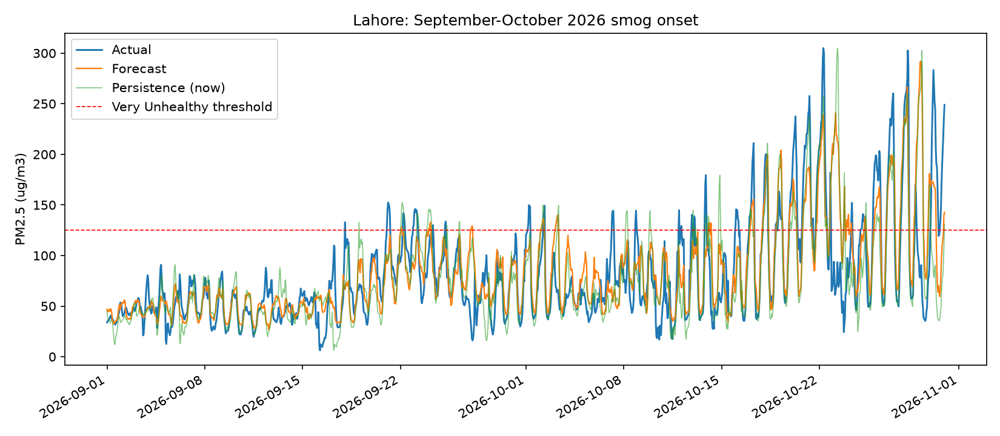
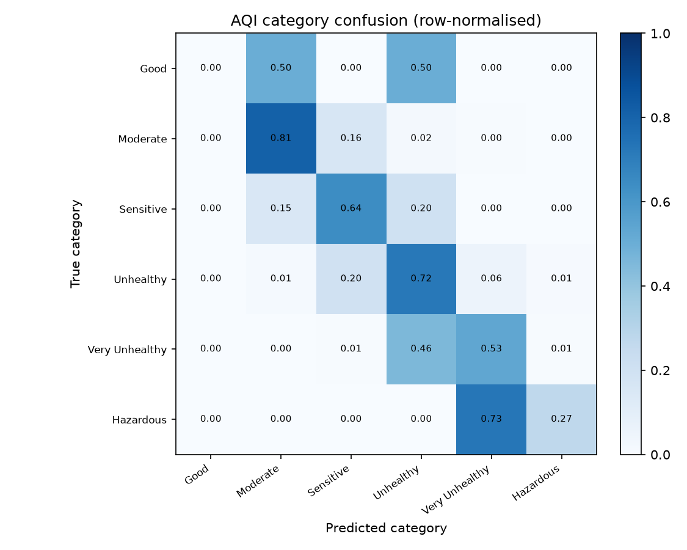

# Next-Day PM2.5 Forecasting for Karachi and Lahore

**CT-378 Machine Learning, Semester Project**

Muhammad Sarim Umer (CT-24235)  
Muhammad Feras Malik (CT-24247)  
Muhammad Ahmed Khan (CT-24245)

---

## The problem

- Most air-quality apps show **today's** reading, not tomorrow's.
- People need time to act: school, exercise, masks, windows, purifiers.
- PM2.5 is the pollutant most strongly linked to respiratory and cardiovascular harm.
- We forecast **PM2.5 at t + 24 hours** for **Karachi** and **Lahore**.

---

## Why machine learning?

PM2.5 depends on interacting processes:

- current pollution and multi-day accumulation
- wind dispersion and humidity-driven trapping
- traffic and weekly cycles
- winter inversions and crop-burning season

A persistence baseline ("tomorrow = now") is strong, so every model must beat it.

---

## Data

| Source | What we use |
|---|---|
| OpenAQ | Hourly PM2.5, up to 12 Karachi + 18 Lahore community sensors |
| Open-Meteo | Temperature, humidity, pressure, wind, rain, cloud cover |
| Open-Meteo CAMS | Regional PM2.5, dust, aerosol optical depth |

- 23,798 cleaned city-hours (11,899 per city)
- Karachi mean 44.6 ug/m3; Lahore mean 103.9 ug/m3
- Community sensors, not regulatory reference instruments

---

## Cleaning and leakage control

1. UTC to Pakistan Standard Time
2. Drop duplicate hours and build a regular hourly grid
3. Reject invalid values, low coverage, and stuck sensors
4. Average sensors by city and hour
5. Interpolate only gaps up to 3 hours
6. **Chronological 70/15/15 split with a 24-hour purge gap**
7. Preprocessing fitted on training data only

No random split: it would leak the future.

---

## 47 features, all past-only

- Current PM2.5, lags 1/3/6/12/24 h, rolling 6/24/72 h
- Momentum: change, velocity, 7-day lag, 24-hour floor
- Domain: acceleration, stagnation index, smog-season curve, Lahore risk
- Regime: 24h/72h excess, clearing index, CAMS divergence
- Weather: direct variables, wind sine/cosine, pressure/wind/rain aggregates
- Calendar: hour, month, weekday, winter flag, cyclic hour
- City: one-hot encoded

Target is the only future value used.

---

## Models and tuning

| Model | Role |
|---|---|
| Persistence | Baseline |
| Ridge | Linear reference |
| KNN | Similar past hours |
| Random Forest | Non-linear interactions |
| LightGBM | Strong gradient boosting |
| Ensemble | Ridge 0.2 + RF 0.3 + LightGBM 0.5 |

Tuning: **5-fold TimeSeriesSplit** (train on earlier data, validate on later data).

---

## Validation results

| Model | MAE | RMSE | R2 | AQI accuracy |
|---|---:|---:|---:|---:|
| Ridge | 10.23 | 15.29 | 0.2645 | 69.2% |
| KNN | 9.08 | 14.18 | 0.3679 | 71.5% |
| Random Forest | **8.43** | **13.67** | **0.4121** | 71.9% |
| LightGBM | 8.49 | 13.78 | 0.4023 | 71.9% |
| Ensemble | 8.45 | 13.70 | 0.4099 | **72.4%** |

Ensemble selected by a pre-declared 0.2 ug/m3 stability rule.

---

## Final test results

| Metric | Baseline | Ensemble | Change |
|---|---:|---:|---:|
| MAE | 14.54 | **13.31** | +8.5% |
| RMSE | 26.98 | **23.65** | +12.3% |
| R2 | 0.5700 | **0.6695** | +0.0995 |
| AQI accuracy | 69.99% | **71.65%** | +1.66 pp |

Evaluated once on 3,492 held-out hours (1,746 per city).

---

## Per-city performance

| City | MAE | RMSE | R2 | AQI accuracy |
|---|---:|---:|---:|---:|
| Karachi | 6.20 | 9.46 | 0.7282 | 82.0% |
| Lahore | 20.42 | 32.08 | 0.5591 | 61.3% |

Lahore is 3.3x harder on MAE and 20.7 points lower on AQI accuracy.

---

## Where it fails

- Top-5% spikes: MAE 41.43, **90.3% underpredicted**
- Rapid clearing: MAE 91.95, **overpredicted**
- Smog onset: MAE 63.26
- Worst day: Lahore 29 Oct 2026, MAE 108.82
- Most category mistakes are **one band away**

---

## AQI and advice

- 2024 US EPA PM2.5 breakpoints
- Linear AQI formula plus category, colour, summary, general advice, sensitive-group advice, action list
- Unit test for **every breakpoint**, both sides of each boundary
- Values truncated to 0.1 ug/m3 so no value falls through a table gap

---

## Product

| Component | What it does |
|---|---|
| `src/live_data.py` | Fetches recent OpenAQ, Open-Meteo, CAMS; aligns in PKT; offline fallback |
| Streamlit | City forecast, AQI card, input snapshot, freshness, manual simulator |
| FastAPI | `/health`, `/predict`, `/aqi`, `/metadata` |
| Hugging Face bundle | Space YAML, requirements, one-command prepare script |

The app labels offline data explicitly. It never silently treats stale data as live.

---

## Limitations and ethics

- Forecast, not a guarantee: crop burning, dust storms, industrial incidents
- Community sensors: spatial and measurement uncertainty
- Lahore transitions are the highest-risk failure mode
- Only ~16 months, one full winter cycle
- US EPA thresholds applied in Pakistan
- Static model: no automatic retraining
- Public environmental data only; no personal data
- Not medical advice

---

## Viva questions

| Question | Short answer |
|---|---|
| Why a chronological split? | Autocorrelation would leak neighbouring test hours; we use a 70/15/15 time split with a 24-hour purge gap. |
| Why not a random train/test split? | It would let the model see the future and inflate scores. |
| Why not deep learning? | Only ~16 months of hourly data; forests and boosting are stronger and faster on tabular data this size. |
| Why select the ensemble if RF had the best MAE? | A pre-declared 0.2 µg/m³ stability rule; the ensemble also had the best validation AQI accuracy. |
| Why is Lahore harder? | Heavy-tailed smog onset/clearing and one winter cycle; Karachi is smoother and close to persistence. |
| Why is AQI accuracy low on spikes? | The inputs at t cannot see an abrupt 24-hour rise, so extreme values are pulled toward the mean. |
| Are the AQI thresholds Pakistani? | No: 2024 US EPA breakpoints, disclosed as a limitation; no equivalent national table is configured. |
| What happens without an API key? | `live_data.py` falls back to the bundled snapshot and labels the result offline. |
| What would you do with more time? | More Lahore winters, city-specific models, fire/crop-burning indicators, and drift monitoring. |

---

## Conclusion

- Complete, reproducible pipeline: data -> features -> split -> tuning -> ensemble
- Beats persistence on MAE, RMSE, R2, and AQI accuracy
- Honest error analysis exposes smog-transition risk
- Deployable through Streamlit, FastAPI, and Hugging Face Spaces
- Next steps: more Lahore winters, city-specific models, external fire data

**Thank you. Questions?**
